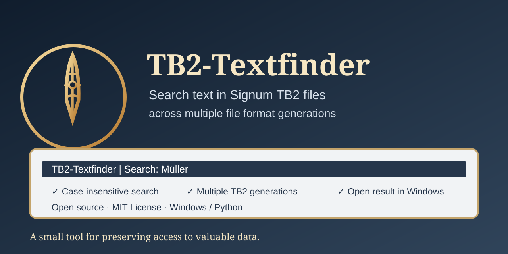
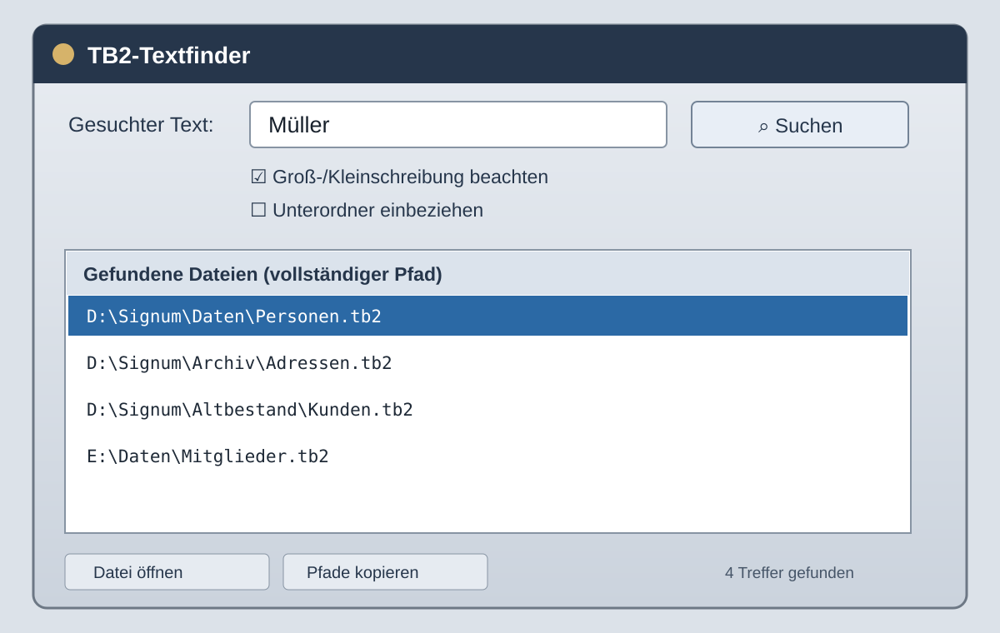

# TB2-Textfinder

<p align="center"></p>

Ein kleines Windows-Programm zum Durchsuchen von `.TB2`-Dateien nach Texten, die in unterschiedlichen Signum-/SignumNext-Dateigenerationen gespeichert sein können.

**Aktueller Entwicklungsstand:** 0.7 (experimentell) · [English version](README_EN.md)



## Funktionen

- Durchsucht einen gewählten Ordner nach `.TB2`-Dateien, auf Wunsch einschließlich Unterordnern.
- Sucht Klartext und mehrere bislang empirisch beobachtete Glyphen-/Datensatzmuster.
- Ignoriert standardmäßig die Groß-/Kleinschreibung, auch bei deutschen Umlauten.
- Zeigt vollständige Dateipfade an.
- Trefferpfade können kopiert oder als TXT-Datei gespeichert werden.
- Treffer lassen sich per Doppelklick oder über **Datei öffnen** mit der in Windows verknüpften Anwendung öffnen.
- TB2-Dateien werden nur gelesen und nicht verändert.

## Programmoberfläche



*Hinweis: Dies ist eine schematische Vorschau, kein echter Screenshot eines laufenden Programms. Das tatsächliche Erscheinungsbild kann je nach Version und Windows-Design abweichen.*

## Starten

Voraussetzung: Windows und Python 3.10 oder neuer mit Tkinter.

1. Dieses Repository herunterladen oder klonen.
2. `Start_TB2_Textfinder.bat` doppelt anklicken.
3. Suchbegriff und Ordner auswählen und auf **Suchen** klicken.

Für den direkten Start des Python-Skripts werden keine zusätzlichen Pakete benötigt.

## Windows-EXE erstellen

1. Python 3.10 oder neuer installieren.
2. `Build_EXE.bat` doppelt anklicken.
3. Beim ersten Lauf wird eine Internetverbindung benötigt, um PyInstaller zu installieren.
4. Die fertige Datei liegt anschließend unter `dist\TB2_Textfinder.exe`.

Das Build-Skript erstellt eine lokale virtuelle Umgebung unter `.venv`, installiert PyInstaller und baut eine einzelne EXE ohne zusätzliches Konsolenfenster. Der Python-Interpreter wird mitgeliefert.

## Bisher untersuchte TB2-Muster

Die folgenden Muster wurden anhand der bislang vorliegenden Beispieldateien empirisch beobachtet:

- Datensatzabstand `0x6A` (106 Bytes) mit Marker `81 00 00`.
- Ein weiteres beobachtetes Markermuster mit 106-Byte-Abstand.
- Älteres Muster mit Abstand `0x50` (80 Bytes) und Marker `81 00 00`.
- Frühes Muster mit Abstand `0x50` (80 Bytes) und Marker `81 7C E9 E4 58 09`.
- Ein-Byte-Zeichenkodierungen wie CP850, CP437, CP1252 und Latin-1 werden bei den Glyphenprofilen berücksichtigt.

Dies ist **keine vollständige oder offizielle Spezifikation** des TB2-Dateiformats. Die Beobachtungen beruhen auf einer begrenzten Zahl von Beispieldateien. Ein Nichttreffer beweist daher nicht, dass der gesuchte Text in einer Datei fehlt.

## Tests

Die Parser-Tests verwenden künstlich erzeugte Bytefolgen und benötigen keine Kundendateien:

```powershell
py -3 -m unittest discover -s tests -v
```

## Datenschutz

Die Suche läuft lokal auf dem Rechner. Das Programm lädt keine TB2-Dateien hoch und verändert sie nicht. Vor dem Teilen von Beispieldateien bitte prüfen, ob diese Kunden- oder andere vertrauliche Daten enthalten.

## Lizenz

Dieses Projekt steht unter der **MIT-Lizenz**. Den vollständigen Lizenztext findest Du in [LICENSE](LICENSE).

## Hinweis

Dieses Projekt ist ein unabhängiges Community-Projekt zur Untersuchung von TB2-Dateien. Es ist nicht mit dem Hersteller von Signum/SignumNext verbunden, wird von diesem nicht unterstützt und ist kein offizielles Produkt.
