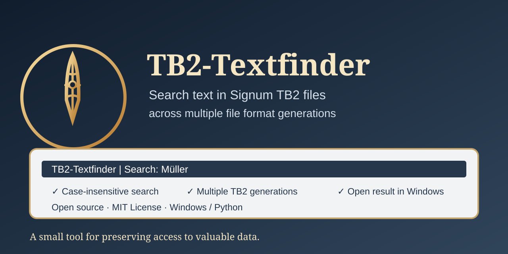
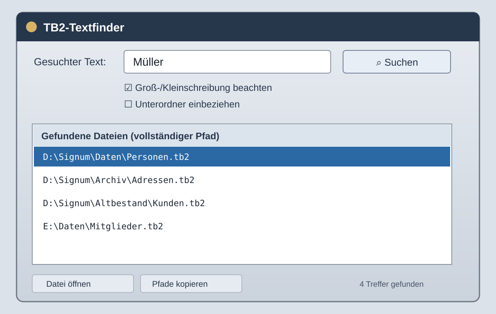

# TB2-Textfinder

<p align="center"></p>

Ein kleines Windows-Programm zum Durchsuchen von `.TB2`-Dateien nach Texten, die in unterschiedlichen Signum-/SignumNext-Dateigenerationen gespeichert sein können.

**Aktueller Entwicklungsstand:** 1.9.2-dev (letztes Release: 1.9.1). · [Änderungsverlauf](CHANGELOG.md) · [English version](README_EN.md)



## Wie dieses Projekt entstanden ist

Der Anlass war ein ganz praktisches Problem aus dem Steinmetzhandwerk: Eine Steininschrift aus dem Jahr 1992 sollte ergänzt werden. Die damalige Beschriftung war noch als Signum-Datei vorhanden – nur welche der vielen Dateien aus diesem Jahr war die richtige?

Um die Vorlage wiederzufinden, musste ich zahlreiche Dateien einzeln in Signum öffnen und durchsehen. Das hat funktioniert, war aber mühsam und zeitaufwendig. Daraus entstand die Idee für den TB2-Textfinder: Warum nicht die alten Dateien direkt nach einem Namen oder einem Text durchsuchen und sich die passenden Dateipfade anzeigen lassen?

Das Programm ist deshalb in erster Linie ein Werkzeug für meinen eigenen Arbeitsalltag. Vielleicht kennt aber auch der eine oder andere Kollege die Situation: Alte digitale Vorlagen sind noch da, doch die Suche nach der richtigen Datei dauert länger als die eigentliche Arbeit.

Die bisher untersuchten Dateien lassen sich in meinem Bestand inzwischen praktisch vollständig bearbeiten beziehungsweise nach manueller Prüfung gezielt ausnehmen. Andere Bestände können bislang unbekannte Dateimuster enthalten; eine vollständige Erkennung aller Signum-Varianten ist nicht garantiert.

## Funktionen

- Durchsucht einen gewählten Ordner nach `.TB2`- und `.TBL`-Dateien, auf Wunsch einschließlich Unterordnern.
- Sucht Klartext und mehrere bislang empirisch beobachtete Glyphen-/Datensatzmuster.
- Zwei Suchmodi: **Schnell** (Standard; überspringt erkannte JPEG-Bereiche) und **Vollständig** (prüft alle Bytes). Die schnelle Suche kann Treffer übersehen.
- Filtert erkennbare eingebettete Ressourcen- und Netzwerkdateipfade, um Fehlalarme zu reduzieren.
- Zeigt nach der Suche die benötigte Laufzeit an.
- **Info**-Fenster mit Hinweisen und vollständiger MIT-Lizenz.
- Ignoriert standardmäßig die Groß-/Kleinschreibung, auch bei deutschen Umlauten.
- Zeigt vollständige Dateipfade an.
- Trefferpfade können kopiert oder als TXT-Datei gespeichert werden.
- Treffer lassen sich per Doppelklick oder über **Datei öffnen** mit der in Windows verknüpften Anwendung öffnen.
- TB2-Dateien werden nur gelesen und nicht verändert.

## Weitere Werkzeuge

- **Negativtester:** Auffällige Dateien prüfen, filtern, ignorieren und als TXT/Diagnose-ZIP exportieren.
- **Textcounter:** Zeichen (ohne Leerzeichen) und Zeilen nach Schriftart zählen. Start über `TB2_Textcounter.py`, Build über `build/Build_EXE.bat`.
- **Regressionstester:** Referenz erstellen und spätere Erkennungsergebnisse einschließlich Zeichenfolgen vergleichen. Start über `Start_Regressiontester.bat`; kompakte JSON-Berichte enthalten Abweichungen und Summen.

## Einstellungen und Ignorierliste

Unter `%LOCALAPPDATA%\Signum Textfinder` liegen die gemeinsamen Einstellungen (`TB2-Textfinder.json`) und die zentrale Ignorierliste (`TB2-Ignore.json`). Suchordner, Suchoptionen und Exportordner werden gespeichert. Die Ignorierliste enthält absolute Dateipfade und SHA-256-Prüfsummen. Geänderte Dateien werden bei Auffälligkeiten erneut angezeigt. Vorhandene `ignore.txt` werden einmalig übernommen, ohne sie zu verändern oder zu löschen. Die zentrale Liste ist benutzer- und rechnerbezogen.

## Programmoberfläche



*Hinweis: Dies ist eine schematische Vorschau, kein echter Screenshot eines laufenden Programms. Das tatsächliche Erscheinungsbild kann je nach Version und Windows-Design abweichen.*

## Starten

Voraussetzung: Windows und Python 3.10 oder neuer mit Tkinter.

1. Dieses Repository herunterladen oder klonen.
2. `Start_TB2_Textfinder.bat` doppelt anklicken.
3. Suchbegriff und Ordner auswählen und auf **Suchen** klicken.

Für den direkten Start des Python-Skripts werden keine zusätzlichen Pakete benötigt. Die Python-Module müssen gemeinsam im Projektordner verbleiben.

## Windows-EXE herunterladen oder selbst erstellen

### Fertige EXE aus einem GitHub-Release

1. Unter [Releases](https://github.com/ropaha/TB2-Textfinder/releases) die gewünschte Version öffnen.
2. Unter **Assets** `TB2_Textfinder.exe`, `TB2_Negativtester.exe` oder `TB2_Textcounter.exe` herunterladen.
3. Die heruntergeladene EXE unter Windows starten. Eine Python-Installation ist dafür nicht erforderlich.

**Hinweis zu Microsoft Defender SmartScreen:** Windows kann beim Start einer heruntergeladenen EXE die Meldung **„Der Computer wurde durch Windows geschützt“** mit **„Unbekannter Herausgeber“** anzeigen. Die Programme sind derzeit nicht digital signiert. Außerdem können Browser Downloads als Dateien aus dem Internet kennzeichnen (Mark of the Web), wodurch Windows eine Reputationsprüfung auslöst. Eine solche Warnung bedeutet nicht automatisch, dass die Datei schädlich ist. Prüfe die Downloadquelle und führe nur Dateien aus, denen du vertraust.

### EXE lokal aus dem Quellcode erstellen

1. Auf der [Repository-Startseite](https://github.com/ropaha/TB2-Textfinder) **Code → Download ZIP** wählen und das ZIP entpacken (alternativ das Repository klonen).
2. Python 3.10 oder neuer installieren.
3. `build/Build_EXE.bat` (alle drei Programme) im entpackten Projektordner doppelt anklicken.
4. Beim ersten Lauf wird eine Internetverbindung benötigt, um die Build-Abhängigkeiten zu installieren.
5. Die fertigen Dateien liegen unter `dist\\TB2_Textfinder.exe`, `dist\\TB2_Negativtester.exe` und `dist\\TB2_Textcounter.exe`.

Die Build-Skripte verwenden eine lokale virtuelle Umgebung unter `.venv`, installieren PyInstaller und erstellen eigenständige EXE-Dateien ohne zusätzliches Konsolenfenster.

**Warum lokal oft keine SmartScreen-Warnung erscheint:** Eine selbst erstellte EXE trägt normalerweise keine Internet-Downloadkennzeichnung. Das bedeutet jedoch **nicht**, dass sie automatisch sicherer ist. Je nach Windows-Konfiguration und Dateibehandlung kann auch bei lokal erstellten Dateien eine Sicherheitswarnung auftreten. Die Build-Skripte führen Python-Code aus und installieren Abhängigkeiten; verwende daher nur eine vertrauenswürdige Quelle.

Der manuelle GitHub-Actions-Test-Build stellt alle drei EXE-Dateien als gemeinsames Artefakt bereit. Der offizielle Release-Workflow veröffentlicht alle drei als einzelne Release-Assets. Der Regressionstester wird nicht als EXE ausgeliefert.

## Bisher untersuchte TB2-Muster

Die folgenden Muster wurden anhand der bislang vorliegenden Beispieldateien empirisch beobachtet:

- Datensatzabstand `0x6A` (106 Bytes) mit Marker `81 00 00`.
- Ein weiteres beobachtetes Markermuster mit 106-Byte-Abstand.
- Älteres Muster mit Abstand `0x50` (80 Bytes) und Marker `81 00 00`.
- Frühes Muster mit Abstand `0x50` (80 Bytes) und Marker `81 7C E9 E4 58 09`.
- Ein-Byte-Zeichenkodierungen wie CP850, CP437, CP1252 und Latin-1 werden bei den Glyphenprofilen berücksichtigt.

Dies ist **keine vollständige oder offizielle Spezifikation** des TB2-Dateiformats. Die Beobachtungen beruhen auf einer begrenzten Zahl von Beispieldateien. Ein Nichttreffer beweist daher nicht, dass der gesuchte Text in einer Datei fehlt.

## Tests

Die Parser-Tests verwenden künstlich erzeugte Bytefolgen und benötigen keine Kundendateien:

```powershell
py -3 -m unittest discover -s tests -v
```

## Datenschutz

Die Suche läuft lokal auf dem Rechner. Das Programm lädt keine TB2-Dateien hoch und verändert sie nicht. Vor dem Teilen von Beispieldateien bitte prüfen, ob diese Kunden- oder andere vertrauliche Daten enthalten.

## Lizenz

Dieses Projekt steht unter der **MIT-Lizenz**. Den vollständigen Lizenztext findest du in [LICENSE](LICENSE) und über **Info → MIT-Lizenz anzeigen** im Programm.

## Hinweis

Dieses Projekt ist ein unabhängiges Community-Projekt zur Untersuchung von TB2-Dateien. Es ist nicht mit dem Hersteller von Signum/SignumNext verbunden, wird von diesem nicht unterstützt und ist kein offizielles Produkt.

## Zentrales Buildsystem

`build/build.py` enthält die gemeinsame PyInstaller-Konfiguration für lokale Builds und beide GitHub-Workflows. `build/Build_EXE.bat` bleibt als einziger Build-Starter erhalten. Alternativ: `python build/build.py all --local`; einzelne Ziele: `textfinder`, `negativtester`, `textcounter`. Mit `--dry-run` werden die Befehle ohne Build angezeigt.
