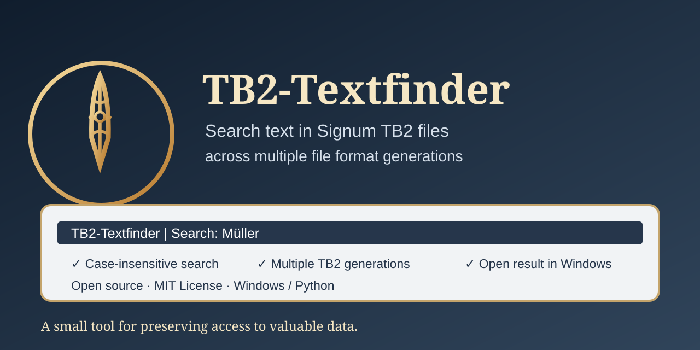
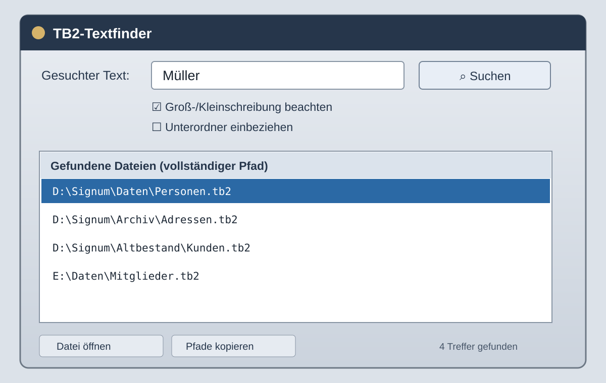

# TB2-Textfinder

A small Windows utility for searching text in `.TB2` files from different Signum / SignumNext file-format generations.

**Current development status:** 0.7 (experimental)



## Features

- Search a selected folder for `.TB2` files, optionally including subfolders.
- Search plain text and several empirically observed glyph/record patterns.
- Case-insensitive search by default, including German umlauts.
- Display full paths for matching files.
- Copy or save matching paths as a text file.
- Open a selected result with the Windows application associated with `.TB2` files, by double-clicking or using the **Datei öffnen** button.
- TB2 files are read-only; the tool does not modify them.

## Interface preview



*Illustrative preview, not an actual screenshot of a running application. The real appearance may vary by version and Windows theme.*

## Run on Windows

Requirements: Windows and Python 3.10 or newer with Tkinter.

1. Download or clone this repository.
2. Double-click `Start_TB2_Textfinder.bat`.
3. Enter a search term, choose a folder, and click **Suchen** (Search).

No third-party packages are required to run the Python script directly.

## Build a standalone Windows executable

1. Install Python 3.10 or newer.
2. Double-click `Build_EXE.bat`.
3. On the first run, an internet connection is needed to install PyInstaller.
4. The executable is created at `dist\TB2_Textfinder.exe`.

The build script creates a local virtual environment in `.venv`, installs PyInstaller there, and builds a single-file, windowed executable. The Python runtime is bundled, so Python does not need to be installed on the target computer.

## Known format observations

The following patterns have been observed in the sample files examined so far:

- 106-byte record spacing (`0x6A`) with marker `81 00 00`.
- Another observed marker using the 106-byte spacing.
- Older 80-byte spacing (`0x50`) with marker `81 00 00`.
- Early 80-byte spacing (`0x50`) with marker `81 7C E9 E4 58 09`.
- Single-byte character encodings such as CP850, CP437, CP1252 and Latin-1 are considered for glyph profiles.

These observations are **not a complete or official specification** of the TB2 file format. They are empirical findings based on a limited set of sample files. A search miss does not prove that the text is absent from a file.

## Tests

The parser tests use synthetic byte sequences and do not require customer data:

```powershell
py -3 -m unittest discover -s tests -v
```

## Privacy

Searches run locally on your computer. The program does not upload TB2 files and does not modify them. Before sharing sample files, make sure they contain no customer or other confidential information.

## License

This project is licensed under the MIT License. See [LICENSE](LICENSE).

## Disclaimer

This is an independent community project for investigating TB2 files. It is not affiliated with, endorsed by, or an official product of the Signum / SignumNext vendor.
